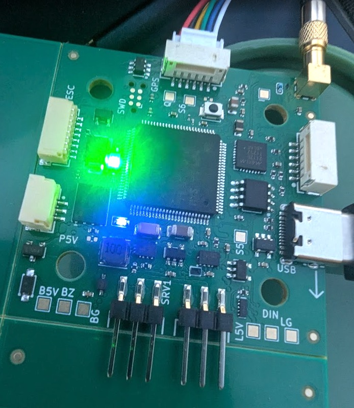
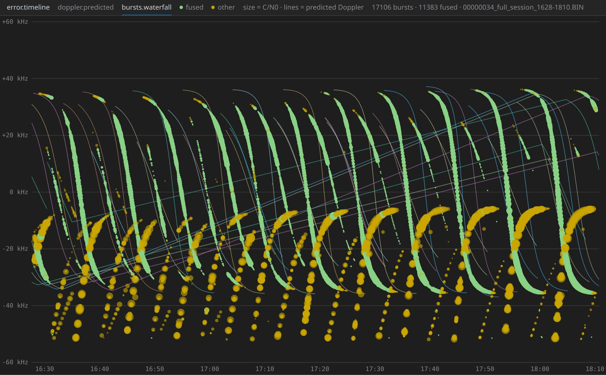
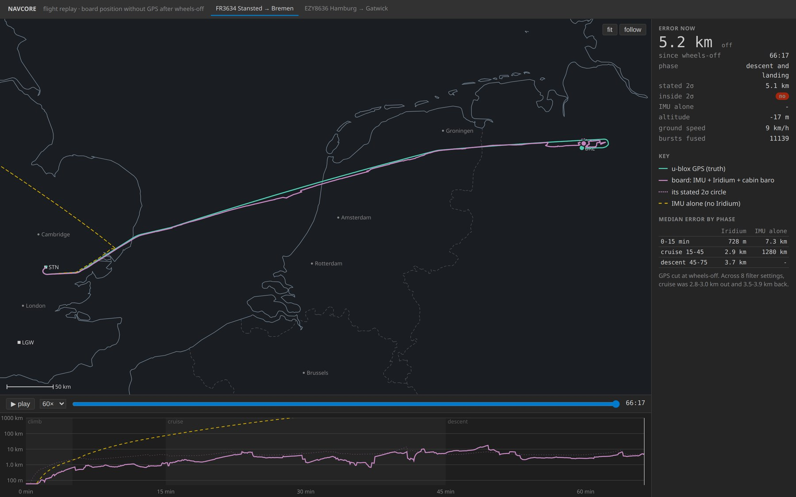
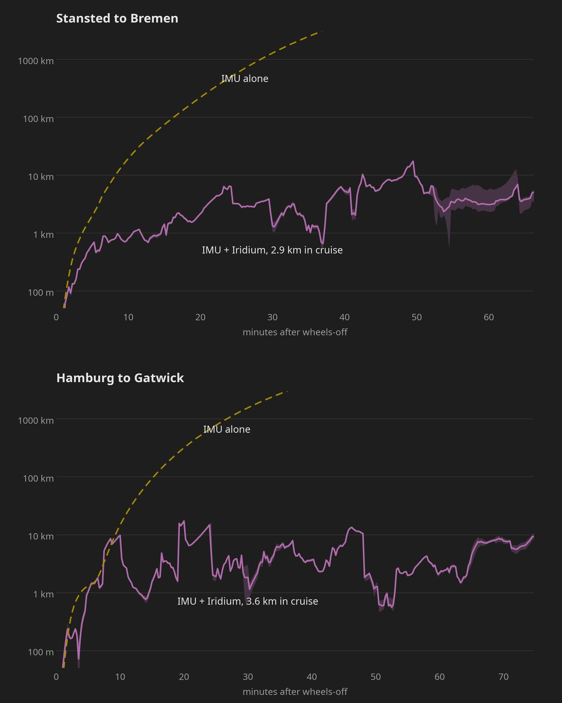

# NAVCORE-SoOP

[](LICENSE)

A 46.5 × 47.2 mm, 6-layer STM32H743 flight controller that navigates without GPS using the Doppler shift of Iridium satellites. It runs ArduPilot with a MatekH743-compatible pinout. Made by Krystian Filipek for my GNSS-denied drone.

<div align="center">




</div>

## Results

### Castle Mound, Cambridge (16 Nov 2026)
First session under the real sky: the board on a tripod with the HC610 antenna, GPS denied in software for 30 and 52 minutes. In 1 h 42 min it heard 17,106 bursts and fused 11,383. Each S-curve is a satellite passing over: dots are measured bursts, lines are the Doppler predicted from its orbit.



Started 3 km off with no GPS and left at rest, Iridium alone settles to 50-130 m median error in replay.

### Two flights (18-19 Nov 2026)
On Stansted → Bremen and Hamburg → Gatwick the board was in my hand luggage at the window, logging the radio, IMU and cabin pressure, with a u-blox GPS logged as truth. I replayed the logs afterwards with GPS cut at wheels-off: the IMU corrected by Iridium Doppler, and the cabin barometer for height.



| Median error over 8 filter settings | Cruise (15-45 min) | Descent (45-75 min) |
|---|---|---|
| FR3634 Stansted → Bremen | 2.8-3.0 km | 3.7-6.0 km |
| EZY8636 Hamburg → Gatwick | 3.5-3.9 km | 3.2-3.4 km |
| The same IMU without Iridium | over 1,000 km | |

None of the 16 runs diverged. The orbits are Space-Track elements from before take-off.

<div align="center">



</div>

These are replays of the logs. In the air the I/Q was mirrored (see Known Issues), so nothing decoded live. The firmware fixes that now; a live run is next.

## Features

### Iridium Navigation
Optical flow and visual-inertial odometry drift without bound over long flights. Iridium NEXT satellites orbit at ~780 km and ~7.5 km/s, and their Ring Alert bursts at 1626.27 MHz arrive shifted by up to ±36 kHz. The shift depends on where you are, so enough bursts give a position, and unlike the IMU it doesn't drift.

- **L-band Receiver** - MAX2112 direct-conversion tuner and OPA2374 baseband filter into the ADCs
- **Antenna Feed** - MMCX port with a current-limited 5 V feed for the active antenna, reported as open, ok or short
- **On-board Navigation** - burst detection, SGP4 orbits and the position solve run on the H743 and feed ArduPilot's EKF as a GPS
- **Spoofing Check** - the real GPS is checked against the Iridium-only fix before it is trusted

### Hardware
| Subsystem | Components |
|-----------|------------|
| MCU | STM32H743VIT6, Cortex-M7 @ 480 MHz, 2 MB flash, 1 MB RAM |
| IMUs | ICM-45686 (SPI1) and ICM-42605 (SPI4) on a separate analogue 3.3 V rail, shared with the tuner |
| Barometer | MS5611 on I2C2 |
| Storage | W25Q128 flash for the orbit catalogue, microSD over SDIO |
| Power | 3S-5S input with TVS and reverse-polarity protection, two LMR33630 bucks (1.6 A system, 2.1 A payload) and three 3.3 V LDOs |
| Connectors | Latching JST-GH on every cable port, two servo headers, MMCX, USB-C, TC2030 SWD pads |
| Protection | ESD clamp on every cable-facing signal, series resistors on the motor, telemetry, current, lidar and servo lines |

### Layer Stackup
```
F.Cu:   MCU, RF receiver, bucks and LDOs, flash, the edge connectors
In1.Cu: Continuous ground plane
In2.Cu: Mixed signal with GND fill
In3.Cu: Mixed signal with GND fill
In4.Cu: Split power planes (+5V, +5V_PAYLOAD, +3V3, VBAT)
B.Cu:   IMUs, baro, both crystals, CAN, microSD, the underside connectors
```

### On the Drone
30.5 mm stack mount, DShot ESC on `J2`, optical flow on `J14`, lidar on `J11`, companion computer on `J21`, DroneCAN on `J6`

### How It Compares
| | NAVCORE-SoOP | SpeedyBee F405 V4 | Matek H743-SLIM V3 | Pixhawk 6C |
|---|---|---|---|---|
| MCU | STM32H743 | STM32F405 | STM32H743 | STM32H743 + F103 |
| IMUs | ICM-45686 + ICM-42605 | ICM-42688-P | ICM-42688-P + ICM-42605 | ICM-42688-P + BMI088 |
| Input | 3-5S | 3-6S | 2-8S | power module |
| Port ESD | every cable signal | none stated | none stated | none stated |
| Position without GNSS | Iridium Doppler | none | none | none |

It has no OSD and no 9-12 V video rail, and it takes 5S at most.

## Known Issues (Rev E)

- **I/Q mirrored.** The I and Q channels arrive swapped, so the receiver heard every burst's mirror image, about 25 dB down. The firmware now turns the spectrum the right way up from Ring Alert decodes (`swap_iq` in `soop.cfg` forces it).
- **RF line impedance.** The board was ordered on JLCPCB's default stackup, which puts the antenna line near 67 Ω rather than 50 Ω.
- **No PPS line.** ArduPilot stamps u-blox fixes when the message arrives, so `gps_lag_s` corrects the time tag. An optional PPS input on TP3 is wired in firmware but untested.
- **Channel 4 unused.** The channel at 1626.4375 MHz carries about 55% more bursts but sits outside the DSP's ±62.5 kHz window; using it live needs a second window.

## Getting Started

### Prerequisites
- **KiCad 9** to open the board and schematic
- **Python 3** with numpy and sgp4, and **ngspice** for the circuit simulations
- **ArduPilot toolchain** for the firmware (`tools/build_firmware.sh` pins Copter-4.7.0)

### Building
1. Clone the repository:
   ```bash
   git clone https://github.com/kfilipekk/iridium_drone.git
   cd iridium_drone
   ```

2. Simulate the analogue blocks (bucks, LDOs, antenna feed, tuner PLL, baseband filter):
   ```bash
   python3 sim/run_suite.py
   ```

3. Build the navigation code and its tests for the host (SGP4, burst detection, the position solve):
   ```bash
   make -C firmware/soop
   ```

4. Build ArduPilot for the board with the SoOP backend:
   ```bash
   bash tools/build_firmware.sh
   ```

### Checking the Board
The checks need KiCad's Python (the `pcbnew` module), and `irdrop.py` needs numpy. Run them from the repository root:
```bash
kicad-cli pcb drc --schematic-parity NAVCORE-SoOP.kicad_pcb
python3 tools/check.py geometry     # acute corners, dangling ends, dead copper, vias in pads
python3 tools/check.py backside     # pins landing under parts on the other side
python3 tools/check.py footprints   # pad counts against JLCPCB's own parts
python3 tools/irdrop.py check       # DC drop and current density on every power rail
python3 tools/fab.py bundle         # gerbers, BOM, CPL and the order sheet, into fab/
```
`--help` on any of them lists the rest.

### Field Sessions and Replays
```bash
python3 tools/soop_plan.py 52.212 0.115           # rank the next hours by satellite geometry
python3 tools/soop_session.py OUT.csv off:1800,on:300   # record both receivers, deny GPS on a plan
python3 tools/soop_live.py OUT.csv                # watch it in the browser
python3 tools/soop_replay.py LOG.BIN TLE --static # run a log through the navigation again
python3 tools/soop_extract.py LOG.BIN LOG.npz     # a flight log to numpy
python3 tools/soop_ins.py LOG.npz TLE BURSTS.csv TRUTH.npz --out FIXES.csv
python3 tools/soop_flightmap.py --flight "LABEL|LOG.npz|FIXES.csv" --basemap DIR map.html
```

### Ordering
The JLCPCB files are in `fab/`: the Gerber and drill bundle, BOM, pick-and-place and schematic PDF. Order 6 layers, 1 oz copper inside and out, ENIG, epoxy-filled and capped vias, and assembly on both sides. Name a controlled-impedance stackup if you want the antenna line at 50 Ω.

## Repository Structure

```
├── NAVCORE-SoOP.kicad_pcb   # PCB
├── NAVCORE-SoOP.kicad_sch   # Schematic, generated from tools/design.py
├── fab/                     # JLCPCB order files
├── firmware/                # ArduPilot hwdef, the SoOP backend and the on-board navigation
├── tools/                   # Design model, board checks, and the soop_* field and replay tools
├── sim/                     # ngspice simulations of the analogue blocks
├── sitl/tle/                # Iridium orbital elements for the host tools
├── cad/                     # OpenSCAD airframe, printed mounts and renders
└── libraries/               # Footprint and symbol libraries
```

## Next

- A live run on the current firmware at Castle Mound
- A second DSP window so channel 4 is used live
- Per-satellite transmitter offsets and fresher orbits, which set the static floor more than the DSP does
- A downward radar for velocity, then flying it on the drone
- Writing up the airliner results
